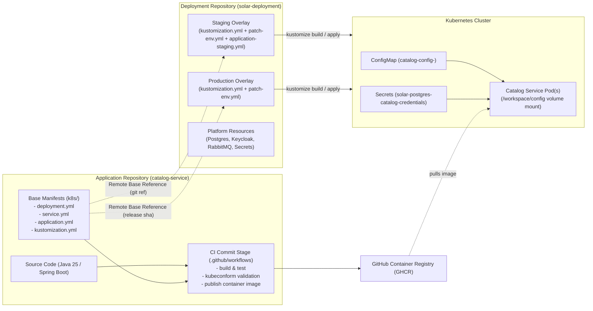
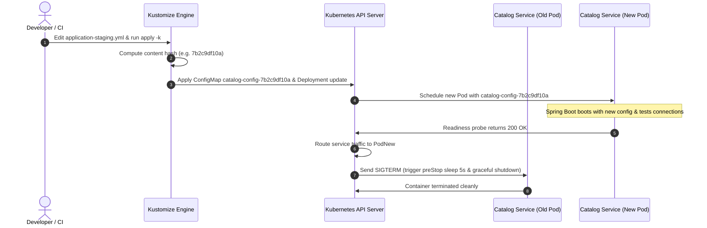
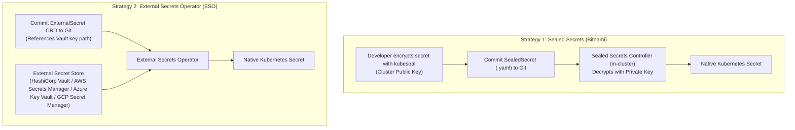

# ⚙️ Configuration & Secrets Management Guide — Solar Bookshop

This document provides a comprehensive architecture, implementation, and operational guide for **Configuration and Secrets Management** in the Solar Bookshop microservices suite. 

Focusing on [`catalog-service`](../catalog-service) as the reference implementation, this guide details how non-sensitive application settings, environment-specific overrides, and sensitive credentials are decoupled, packaged, and lifecycle-managed using **Spring Boot**, **Kubernetes ConfigMaps & Secrets**, and **Kustomize** overlays.

---

## 📑 Table of Contents

1. [Architectural Principles & 15-Factor Methodology](#-architectural-principles--15-factor-methodology)
2. [Evolution: From Spring Cloud Config to Cloud-Native Kubernetes](#-evolution-from-spring-cloud-config-to-cloud-native-kubernetes)
3. [Spring Boot Externalized Configuration Architecture](#-spring-boot-externalized-configuration-architecture)
4. [Catalog Service: Base Configuration & Volume Mounts](#-catalog-service-base-configuration--volume-mounts)
5. [Kustomize Architecture: Base vs. Overlays](#-kustomize-architecture-base-vs-overlays)
6. [Staging & Production Overlays in `solar-deployment`](#-staging--production-overlays-in-solar-deployment)
7. [Automated Rolling Restarts via Hash Suffixing](#-automated-rolling-restarts-via-hash-suffixing)
8. [Secrets Management: Protection, Ingestion & GitOps](#-secrets-management-protection-ingestion--gitops)
9. [Modern Evolution: EPUB vs. Current Implementation](#-modern-evolution-epub-vs-current-implementation)
10. [Local Development, CI/CD & Verification Workflows](#-local-development-cicd--verification-workflows)
11. [Troubleshooting & Best Practices](#-troubleshooting--best-practices)

---

## 🎯 Architectural Principles & 15-Factor Methodology

Modern cloud-native applications adhere to the **15-Factor App** principles (specifically *Factor III: Config*):
- **Separate Code from Configuration**: A release artifact (e.g., container image or JAR) must be compiled and packaged **exactly once** and promoted unchanged through Development, Staging, and Production.
- **Environment Parity**: Any setting that changes between deployment targets (database connection strings, active profiles, feature flags, replicas, or external API endpoints) must be injected from the deployment environment.
- **Strict Separation of Credentials**: Sensitive credentials (passwords, tokens, private keys) must never be checked into version control, embedded in source code, or mixed with non-sensitive application configuration.
- **Repository Decoupling**: Application source code and base deployment manifests belong in the application repository ([`catalog-service`](../catalog-service)), while cross-cutting deployment overlays, environment configurations, and cluster platform definitions reside in the deployment repository ([`solar-deployment`](./)). This establishes clear ownership boundaries and enables independent GitOps reconciliation.



---

## 🔄 Evolution: From Spring Cloud Config to Cloud-Native Kubernetes

In early stages of microservice development (e.g., Docker Compose or VM environments), a dedicated **Spring Cloud Config Server** is often used. However, running Spring Cloud Config on Kubernetes introduces operational redundancy:

| Aspect | Spring Cloud Config Server | Native Kubernetes (ConfigMaps + Secrets) |
| :--- | :--- | :--- |
| **Architectural Complexity** | High. Requires running and maintaining a separate JVM service (`config-service`), backing Git repo, and network routing. | None. Built natively into Kubernetes control plane (`kube-apiserver` and `etcd`). |
| **Availability Dependency** | Critical SPOF during bootstrap. If `config-service` is down, dependent services fail to start (unless `fail-fast: false`). | High availability guaranteed by Kubernetes control plane and node kubelets. |
| **Security Surface** | Requires securing HTTP endpoints (Basic Auth or OAuth2 client credentials) and key management for `/encrypt` and `/decrypt`. | Governed by Kubernetes RBAC, ServiceAccounts, and optional encryption at rest in etcd. |
| **Refresh Mechanism** | Spring Cloud Bus over RabbitMQ/Kafka, `/actuator/refresh`, or Spring Cloud Config Monitor webhooks. | Automatic rolling restarts via Kustomize content-hash suffixing, or in-place volume updates. |
| **Container Portability** | Application code requires client dependencies (`spring-cloud-starter-config`). | Platform-agnostic. Containers read standard YAML files from filesystem volumes. |

### Disabling Spring Cloud Config in Catalog Service

To transition to native Kubernetes configuration without deleting legacy configurations, [`catalog-service/src/main/resources/application.yml`](../catalog-service/src/main/resources/application.yml) explicitly disables the Spring Cloud Config Client:

```yaml
spring:
  config:
    import: ""              # ❶ Clears any external config server imports
  cloud:
    config:
      enabled: false        # ❷ Disables Spring Cloud Config Client integration
      uri: http://localhost:8888
      request-connect-timeout: 5000
      request-read-timeout: 5000
      fail-fast: false
```

- `spring.config.import: ""` stops Spring Boot from attempting to connect to `optional:configserver:`.
- `spring.cloud.config.enabled: false` ensures the client autoconfiguration is bypassed completely.

---

## 🍃 Spring Boot Externalized Configuration Architecture

Spring Boot loads configuration properties from an established hierarchy (from lowest to highest precedence):

1. Default properties inside packaged JAR (`src/main/resources/application.yml`)
2. Profile-specific properties inside packaged JAR (`application-{profile}.yml`)
3. External application properties outside the JAR (`./config/application.yml` or `/workspace/config/application.yml`)
4. External profile-specific application properties (`./config/application-{profile}.yml`)
5. Environment variables (e.g., `SPRING_PROFILES_ACTIVE`, `BPL_JVM_THREAD_COUNT`)
6. Command-line arguments

### Why `/workspace/config`?

In Cloud Native Buildpacks (Paketo buildpack used by `./gradlew bootBuildImage`), the application executable is extracted into `/workspace`. 

Spring Boot automatically searches for external configuration files in:
1. `file:./config/` (relative to working directory -> `/workspace/config/`)
2. `file:./` (working directory -> `/workspace/`)
3. `classpath:/config/`
4. `classpath:/`

By mounting a Kubernetes ConfigMap containing `application.yml` into `/workspace/config`, **Spring Boot automatically detects and loads the external configuration file on startup without requiring any custom `spring.config.additional-location` parameters**.

---

## 📦 Catalog Service: Base Configuration & Volume Mounts

The base configuration for [`catalog-service`](../catalog-service) is located in [`catalog-service/k8s/`](../catalog-service/k8s).

### 1. The Base Application Properties

[`catalog-service/k8s/application.yml`](../catalog-service/k8s/application.yml):

```yaml
solar:
  greeting: Welcome to the book catalog from Kubernetes 👋
spring:
  datasource:
    url: jdbc:postgresql://solar-postgres/solardb_catalog
  security:
    oauth2:
      resourceserver:
        jwt:
          issuer-uri: http://solar-keycloak/realms/SolarBookshop
```

### 2. Base Kustomization (`k8s/kustomization.yml`)

Instead of writing a static `ConfigMap` manifest with raw multiline strings, Kustomize generates the ConfigMap directly from [`application.yml`](../catalog-service/k8s/application.yml):

```yaml
resources:
  - deployment.yml
  - service.yml

configMapGenerator:
  - name: catalog-config
    files:
      - application.yml
    options:
      labels:
        app: catalog-service
```

### 3. Base Deployment (`k8s/deployment.yml`)

The Deployment manifest mounts the generated `catalog-config` ConfigMap into the container filesystem:

```yaml
apiVersion: apps/v1
kind: Deployment
metadata:
  name: catalog-service
  labels:
    app: catalog-service
spec:
  selector:
    matchLabels:
      app: catalog-service
  template:
    metadata:
      labels:
        app: catalog-service
      annotations:
        prometheus.io/scrape: "true"
        prometheus.io/path: "/actuator/prometheus"
        prometheus.io/port: "9001"
    spec:
      containers:
        - name: catalog-service
          image: catalog-service
          imagePullPolicy: IfNotPresent
          lifecycle:
            preStop:
              exec:
                command: [ "sh", "-c", "sleep 5" ]
          ports:
            - containerPort: 9001
          env:
            - name: BPL_JVM_THREAD_COUNT
              value: "10"
            - name: SPRING_PROFILES_ACTIVE
              value: testdata
          volumeMounts:
            - name: catalog-config-volume
              mountPath: /workspace/config      # ❶ Injected as /workspace/config/application.yml
          livenessProbe:
            httpGet:
              path: /actuator/health/liveness
              port: 9001
            initialDelaySeconds: 10
            periodSeconds: 5
          readinessProbe:
            httpGet:
              path: /actuator/health/readiness
              port: 9001
            initialDelaySeconds: 5
            periodSeconds: 15
      volumes:
        - name: catalog-config-volume
          configMap:
            name: catalog-config                # ❷ Kustomize renames this to catalog-config-<hash>
```

#### Why Volume Mounts over Environment Variables?

1. **Maintainability**: New properties added to `application.yml` do not require editing the Deployment manifest or adding new `env` entries.
2. **Type Safety & Structure**: Hierarchical YAML structures (nested maps, arrays, multiline strings) are preserved cleanly.
3. **Security**: Environment variables are easily leaked in process listings (`ps -ef`), crash dumps, or error reports.
4. **Automated Hash Tracking**: Kustomize only hashes files in `configMapGenerator`, enabling automated rolling updates when the file contents change.

---

## 🗂️ Kustomize Architecture: Base vs. Overlays

Kustomize operates on a pure declarative layering model:
- **Base**: Defines the default, environment-agnostic state of the application. It contains the primary Deployment, Service, and default `application.yml`.
- **Overlay**: Defines environment-specific customizations (Staging, Production) applied on top of the Base using patches, generators, image overrides, and replica specifications.

```
solarbookshop/
├── catalog-service/                      # [APPLICATION REPOSITORY]
│   └── k8s/                              # BASE KUSTOMIZATION
│       ├── kustomization.yml             # Composes manifests & generates catalog-config
│       ├── deployment.yml                # Pod template & volume mount /workspace/config
│       ├── service.yml                   # Service port mapping (80 -> 9001)
│       └── application.yml               # Base non-sensitive properties
│
└── solar-deployment/                     # [DEPLOYMENT REPOSITORY]
    └── kubernetes/
        └── applications/
            └── catalog-service/
                ├── staging/              # STAGING OVERLAY
                │   ├── kustomization.yml # References remote base + applies overlays
                │   ├── patch-env.yml     # Overrides SPRING_PROFILES_ACTIVE=staging
                │   └── application-staging.yml # Environment-specific properties
                └── production/           # PRODUCTION OVERLAY
                    ├── kustomization.yml # Points to release SHA base
                    └── patch-env.yml     # Overrides SPRING_PROFILES_ACTIVE=prod
```

---

## 🚀 Staging & Production Overlays in `solar-deployment`

### 1. Staging Overlay Configuration

Located at [`kubernetes/applications/catalog-service/staging/`](./kubernetes/applications/catalog-service/staging):

#### `staging/kustomization.yml`
```yaml
resources:
  - github.com/solarbookshop/catalog-service/k8s?ref=main

patches:
  - path: patch-env.yml

configMapGenerator:
  - behavior: merge
    files:
      - application-staging.yml
    name: catalog-config

images:
  - name: catalog-service
    newName: ghcr.io/solarbookshop/catalog-service
    newTag: latest

replicas:
  - name: catalog-service
    count: 2
```

Key customizations applied in Staging:
1. **Remote Base Reference**: Fetches the base manifests from GitHub (`?ref=main`).
2. **Strategic Merge Patch (`patch-env.yml`)**: Injects environment variable `SPRING_PROFILES_ACTIVE=staging`.
3. **ConfigMap Merging (`behavior: merge`)**: Combines [`application-staging.yml`](./kubernetes/applications/catalog-service/staging/application-staging.yml) into the existing `catalog-config` ConfigMap. Both `application.yml` and `application-staging.yml` will be placed in `/workspace/config/`.
4. **Image Override (`images`)**: Switches from the local image to GitHub Container Registry (`ghcr.io/solarbookshop/catalog-service:latest`).
5. **High Availability (`replicas: 2`)**: Increases the replica count from 1 to 2 for resilience and load verification.

#### `staging/patch-env.yml`
```yaml
apiVersion: apps/v1
kind: Deployment
metadata:
  name: catalog-service
spec:
  template:
    spec:
      containers:
        - name: catalog-service
          env:
            - name: SPRING_PROFILES_ACTIVE
              value: staging
```

#### `staging/application-staging.yml`
```yaml
solar:
  greeting: Welcome to the book catalog from staging K8s environment 👋📚✨🚀
```

When Spring Boot starts with `SPRING_PROFILES_ACTIVE=staging`:
1. It loads `/workspace/config/application.yml`.
2. It subsequently loads `/workspace/config/application-staging.yml`.
3. Properties in `application-staging.yml` override matching keys in `application.yml`, changing the greeting message while keeping the datasource and security settings intact!

---

### 2. Production Overlay Configuration

Located at [`kubernetes/applications/catalog-service/production/`](./kubernetes/applications/catalog-service/production):

#### `production/kustomization.yml`
```yaml
resources:
  - github.com/solarbookshop/catalog-service/k8s?ref=<release_sha>

patches:
  - path: patch-env.yml
```

#### `production/patch-env.yml`
```yaml
apiVersion: apps/v1
kind: Deployment
metadata:
  name: catalog-service
spec:
  template:
    spec:
      containers:
        - name: catalog-service
          env:
            - name: SPRING_PROFILES_ACTIVE
              value: prod
```

In production:
- The base reference pins an **immutable Git SHA commit** (`?ref=<release_sha>`) rather than mutable `main`, ensuring deterministic, reproducible deployments.
- The `prod` profile disables mock data initialization (`testdata`) and enforces production data source pooling, metrics, and security.

---

## ⚡ Automated Rolling Restarts via Hash Suffixing

One of the greatest operational benefits of Kustomize's `configMapGenerator` is **automatic zero-downtime rolling updates**.

### The Problem with Static ConfigMaps
If you deploy a static `ConfigMap` without Kustomize and update its values:
1. Kubernetes updates the volume files inside the Pod after a short kubelet sync delay.
2. However, **Spring Boot does not reload configuration files automatically**. Spring beans created at startup continue running with obsolete in-memory values.
3. Unless someone manually executes `kubectl rollout restart deployment catalog-service`, the application runs in a desynchronized state.

### How Kustomize Solves This
1. Kustomize computes a SHA-256 hash of the contents of all files listed in `configMapGenerator`.
2. It appends the first 10 characters of the hash to the ConfigMap name (e.g., `catalog-config-8f9bg95tk6`).
3. It updates the `volumes.configMap.name` in the Deployment manifest to match this exact hashed name.
4. When you change `application.yml` or `application-staging.yml` and run `kubectl apply -k`:
   - Kustomize generates a new ConfigMap (e.g., `catalog-config-7b2c9df10a`).
   - The Deployment manifest's Pod template spec changes.
   - Kubernetes recognizes a change in the Pod specification and initiates a standard **rolling update**.
   - A new Pod starts up, runs probes, passes readiness checks, and begins serving traffic.
   - The old Pod is sent `SIGTERM`, waits out the `preStop` hook (5s), and shuts down gracefully with zero downtime!



> [!TIP]
> If runtime reload without container restarts is ever required, you can disable the hash suffix with `generatorOptions: { disableNameSuffixHash: true }` and deploy the **Spring Cloud Kubernetes Configuration Watcher** or **Stakater Reloader** controller to trigger `/actuator/refresh`. For standard workloads, however, rolling restarts preserve **Pod immutability** and are strongly recommended.

---

## 🔐 Secrets Management: Protection, Ingestion & GitOps

### The Cardinal Rule: Kubernetes Secrets Are NOT Secret by Default

A standard Kubernetes `Secret` stores data encoded in **Base64**:

```shell
$ kubectl get secret solar-postgres-catalog-credentials -o jsonpath="{.data.spring\\.datasource\\.password}"
c2VjcmV0

$ echo "c2VjcmV0" | base64 --decode
secret
```

Base64 is an **encoding format**, not encryption. Therefore:
> [!CAUTION]
> **Never commit raw Kubernetes Secret manifests to Git!** Storing unencrypted secrets in version control compromises cluster security and violates compliance standards.

---

### Ingesting Secrets into Catalog Service

In production (e.g., DigitalOcean Kubernetes), secrets are passed to microservices through two primary patterns:

#### Pattern A: Direct Literal Injection (Operational Bootstrap)
Used in [`DIGITALOCEAN_SETUP.md`](./kubernetes/platform/production/DIGITALOCEAN_SETUP.md#L80-L86):

```shell
kubectl create secret generic solar-postgres-catalog-credentials \
   --from-literal=spring.datasource.url="jdbc:postgresql://<postgres_host>:<postgres_port>/solardb_catalog" \
   --from-literal=spring.datasource.username="<postgres_username>" \
   --from-literal=spring.datasource.password="<postgres_password>"
```

And for Keycloak OAuth2 Resource Server in [`create-secrets.sh`](./kubernetes/platform/production/keycloak/create-secrets.sh):

```shell
kubectl create secret generic keycloak-issuer-resourceserver-secret \
   --from-literal=spring.security.oauth2.resourceserver.jwt.issuer-uri="$1"
```

#### Pattern B: Mapping Secrets via Deployment Patches
In production overlays, secrets are mapped to environment variables or volume mounts via a Kustomize patch:

```yaml
# patch-secret-env.yml
apiVersion: apps/v1
kind: Deployment
metadata:
  name: catalog-service
spec:
  template:
    spec:
      containers:
        - name: catalog-service
          envFrom:
            - secretRef:
                name: solar-postgres-catalog-credentials
            - secretRef:
                name: keycloak-issuer-resourceserver-secret
```

---

### Production GitOps Secret Strategies

To manage secrets declaratively within GitOps pipelines (such as ArgoCD or Flux), use one of the two industry-standard patterns:



#### 1. Bitnami Sealed Secrets
- **How it works**: An in-cluster controller manages an asymmetric RSA key pair. Developers encrypt raw secrets locally using the CLI tool `kubeseal` against the controller's public key.
- **Git Safety**: The generated `SealedSecret` custom resource can be safely committed to the Git repository. Only the controller possessing the private key inside the cluster can decrypt it into a standard Kubernetes `Secret`.

#### 2. External Secrets Operator (ESO)
- **How it works**: Secrets are stored centrally in dedicated vault services (HashiCorp Vault, AWS Secrets Manager, Azure Key Vault, or Google Cloud Secret Manager).
- **Git Safety**: Developers commit an `ExternalSecret` manifest that points to the remote vault key. The ESO controller connects to the vault, retrieves the credentials, and creates the native Kubernetes `Secret`.

#### 3. Kubernetes Encryption at Rest
Platform engineers must configure `EncryptionConfiguration` on the Kubernetes API Server (`kube-apiserver`) so that Secret resources are stored encrypted in `etcd` using providers like `aescbc`, `aesgcm`, or a Cloud KMS plugin.

---

## 🔬 Modern Evolution: EPUB vs. Current Implementation

While the provided EPUB (Chapter 14) lays out solid foundations, cloud-native tools have evolved. The Solar Bookshop implementation adopts modern best practices:

| Feature / Area | EPUB (Chapter 14) | Solar Bookshop Implementation | Rationale / Benefits |
| :--- | :--- | :--- | :--- |
| **Kustomize Patch Syntax** | `patchesStrategicMerge:`<br/>`- patch-env.yml` | `patches:`<br/>`- path: patch-env.yml` | `patchesStrategicMerge` is deprecated in Kustomize v5. The unified `patches:` array supports both strategic merge and RFC 6902 JSON 6902 patches. |
| **K8s Manifest Validation** | `kubeval` in GitHub Actions (`stefanprodan/kube-tools`) | `kubeconform` via Arkade in [`commit-stage.yml`](../catalog-service/.github/workflows/commit-stage.yml) | `kubeval` is unmaintained and lacks support for modern Kubernetes schemas and CRDs. `kubeconform` is the modern, high-performance standard. |
| **Tool Installation in CI** | Direct binary curl or legacy actions | Arkade tool manager (`alexellis/setup-arkade@v3` + `alexellis/arkade-get@master`) | Declarative, version-pinned, multi-tool installation in CI pipelines. |
| **Spring Boot Config Import** | Legacy bootstrap or basic `spring.config.import` | Standard `spring.config.import: ""` with `spring.cloud.config.enabled: false` | Completely disables the Cloud Config client in favor of clean volume mounts. |
| **Actuator Refresh Endpoint** | Exposes `/actuator/refresh` | Actuator `refresh` endpoint removed from web exposure | Eliminates mutable in-memory state in favor of Kubernetes immutable rolling rollouts. |
| **Database & Cache Tech** | Standalone PostgreSQL & Redis | PostgreSQL 18 & Valkey 8 (`solar-valkey`) | Modernized database versions and open-source Valkey protocol-compatible caching. |

---

## 🛠️ Local Development, CI/CD & Verification Workflows

### 1. Validating Kustomize Manifests Locally

You can preview the exact Kubernetes manifests generated by Kustomize before applying them:

```bash
# Build base manifests from catalog-service
kustomize build ../catalog-service/k8s

# Build staging manifests from solar-deployment
kustomize build ./kubernetes/applications/catalog-service/staging

# Validate generated manifests strictly with kubeconform
kustomize build ../catalog-service/k8s | kubeconform --strict -
```

---

### 2. Live Local Development with Tilt

During local development on Minikube, [`catalog-service/Tiltfile`](../catalog-service/Tiltfile) uses Kustomize natively:

```python
# Deploy via Kustomize base
k8s_yaml(kustomize('k8s'))

# Manage port forwards
k8s_resource('catalog-service', port_forwards=['9001'])
```

Tilt automatically watches `k8s/application.yml` and triggers live container updates when properties change.

---

### 3. Step-by-Step Staging Deployment & Verification

```bash
# 1. Start local Minikube cluster with platform services
cd kubernetes/platform/development
./create-cluster.sh

# 2. Deploy Staging Overlay using Kustomize
cd ../../applications/catalog-service/staging
kubectl apply -k .

# 3. Verify ConfigMap generated with hash suffix
kubectl get cm -l app=catalog-service
# Expected output:
# NAME                         DATA   AGE
# catalog-config-m856d2b457    2      15s

# 4. Inspect the generated ConfigMap data
kubectl describe cm -l app=catalog-service
# Notice both application.yml and application-staging.yml are present!

# 5. Monitor the Pods and verify 2 replicas are running
kubectl get pods -l app=catalog-service -o wide

# 6. Check active Spring profile in container logs
kubectl logs deployment/catalog-service --tail=50
# Look for: "The following 1 profile is active: 'staging'"

# 7. Port-forward and verify endpoint response
kubectl port-forward service/catalog-service 9001:80
# In another terminal:
curl -s http://localhost:9001/
# Expected: "Welcome to the book catalog from staging K8s environment 👋📚✨🚀"
```

---

### 4. Verifying Zero-Downtime Rolling Restarts

To verify that configuration changes trigger a smooth rolling restart:

1. Open a terminal and watch the pods:
   ```bash
   kubectl get pods -l app=catalog-service -w
   ```
2. Update the message in [`application-staging.yml`](./kubernetes/applications/catalog-service/staging/application-staging.yml):
   ```yaml
   solar:
     greeting: Updated greeting message in staging! ✨
   ```
3. Re-apply the Kustomization:
   ```bash
   kubectl apply -k .
   ```
4. Observe the watch output:
   - A new pod is created with the new ConfigMap hash.
   - Once the new pod passes its readiness probe, the old pod receives `SIGTERM` and terminates gracefully.
   - Traffic continues serving without dropping a single HTTP request!

---

## 🔍 Troubleshooting & Best Practices

| Symptom / Issue | Root Cause | Solution |
| :--- | :--- | :--- |
| **Pod stuck in `CreateContainerConfigError`** | The ConfigMap referenced in `volumes.configMap.name` does not exist. | Ensure you applied via `kubectl apply -k .` (which applies both the generated ConfigMap and the Deployment together) instead of `kubectl apply -f deployment.yml`. |
| **Properties in `application-staging.yml` not taking effect** | The `staging` profile was not activated. | Check `patch-env.yml` and ensure `SPRING_PROFILES_ACTIVE` contains `staging`. Check pod logs (`kubectl logs deploy/catalog-service`). |
| **Spring Boot fails with `ConfigDataLocationNotFoundException`** | `spring.config.import` points to a non-existent file or server. | Verify `spring.config.import: ""` is set in `src/main/resources/application.yml` and that ConfigMaps are mounted to `/workspace/config`. |
| **PostgreSQL Authentication Failure** | Secret values do not match the database username/password. | Check the secret keys (`spring.datasource.username`, `spring.datasource.password`). Remember that Base64 values created with `echo` might contain trailing newlines; use `echo -n "secret" \| base64` or `--from-literal=...`. |
| **Kubeconform validation failure in CI** | Outdated or non-standard manifest syntax. | Test locally using `kustomize build k8s \| kubeconform --strict -`. Ensure API versions match your target Kubernetes release (e.g., `apps/v1` for Deployments). |

---

## 📚 References & Further Reading

- [Spring Boot Externalized Configuration](https://docs.spring.io/spring-boot/docs/current/reference/html/features.html#features.external-config)
- [Kubernetes ConfigMaps](https://kubernetes.io/docs/concepts/configuration/configmap/)
- [Kubernetes Secrets](https://kubernetes.io/docs/concepts/configuration/secret/)
- [Kustomize Official Documentation](https://kubectl.docs.kubernetes.io/)
- [Bitnami Sealed Secrets](https://github.com/bitnami-labs/sealed-secrets)
- [External Secrets Operator](https://external-secrets.io/)
- [Observability & Monitoring Guide in Solar Bookshop](./OBSERVABILITY.md)
