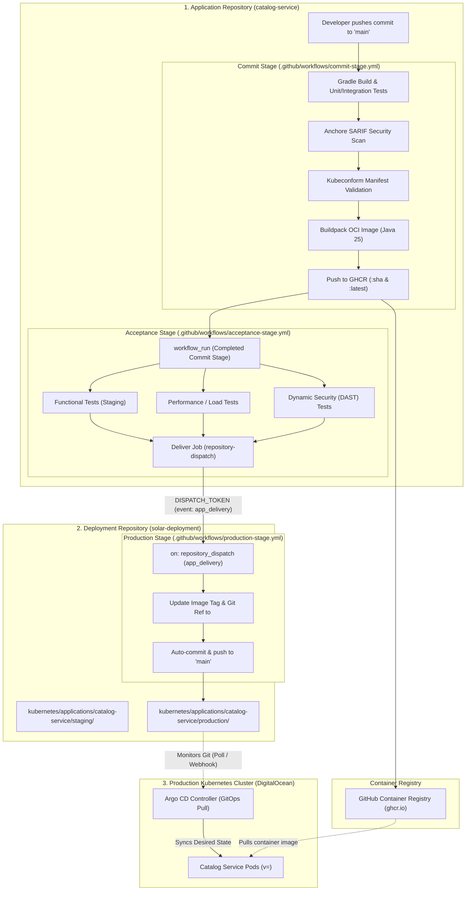
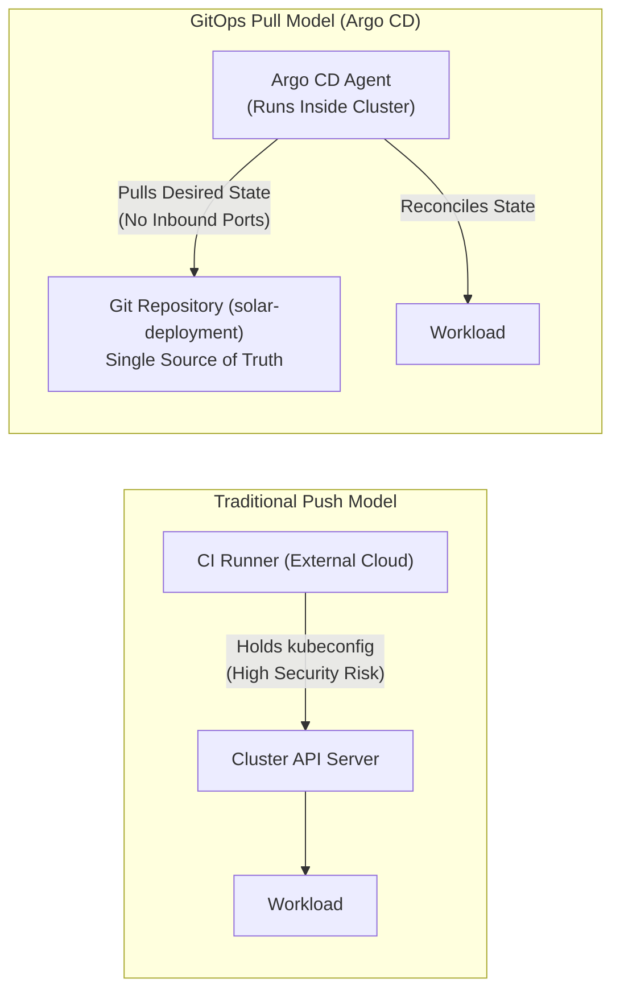

# 🚢 Continuous Delivery & GitOps Guide — Solar Bookshop

This document provides a comprehensive operational and architectural guide for the **Continuous Delivery (CD) and GitOps pipeline** in the Solar Bookshop microservices suite.

Focusing on [`catalog-service`](../catalog-service) as the reference implementation, this guide details how an application progresses from code commit to release candidate, passes through automated **Acceptance (Staging)** verification, and is continuously promoted and deployed to **Production** using **GitHub Actions**, **Kustomize**, and **Argo CD**.

---

## 📑 Table of Contents

1. [Continuous Delivery Principles & Release Versioning](#-continuous-delivery-principles--release-versioning)
2. [End-to-End Delivery Pipeline Architecture](#-end-to-end-delivery-pipeline-architecture)
3. [Stage 1: Commit Stage (Application Repository)](#-stage-1-commit-stage-application-repository)
4. [Stage 2: Acceptance & Staging Stage](#-stage-2-acceptance--staging-stage)
5. [Configuring Spring Boot for Production](#-configuring-spring-boot-for-production)
6. [Stage 3: Production Delivery & Manifest Promotion](#-stage-3-production-delivery--manifest-promotion)
7. [Stage 4: Continuous Deployment with GitOps (Argo CD)](#-stage-4-continuous-deployment-with-gitops-argo-cd)
8. [Implementation Status & Step-by-Step Roadmap](#-implementation-status--step-by-step-roadmap)
9. [Operational Cheatsheet & Troubleshooting](#-operational-cheatsheet--troubleshooting)

---

## 🎯 Continuous Delivery Principles & Release Versioning

Continuous delivery is a software development discipline where software is built such that it can be released to production at any time.

### Core Principles

- **Always Releasable**: Every commit on the `main` branch is treated as a potential release candidate.
- **Single Build Artifact**: A container image is built and packaged **only once** during the Commit Stage. The identical image is evaluated through Acceptance/Staging and promoted to Production.
- **Decoupled Repositories**:
  - Application source code and base manifests reside in [`catalog-service`](../catalog-service).
  - Environment overlays, platform configurations, and cluster desired state reside in [`solar-deployment`](./).
- **Separation of Delivery and Deployment (GitOps)**: The CI pipeline is responsible for *delivery* (producing artifacts and updating manifest versions in Git). An in-cluster GitOps controller (*Argo CD*) is responsible for *deployment* (pulling desired state from Git into the cluster).

### Versioning Strategy: Git Commit SHA vs. Semantic Versioning

In traditional release management, teams manually tag versions using Semantic Versioning (`v1.0.0`, `v1.0.1`). However, in automated continuous delivery:

1. **Traceability**: Using the **Git commit SHA** (`${{ github.sha }}`) establishes a direct, unambiguous link between the container image running in production and the exact source code commit that generated it.
2. **Immutability & Automation**: The Git SHA is unique, automatically generated, and requires no manual tagging or human coordination.
3. **Dual Tagging**: In [`catalog-service/.github/workflows/commit-stage.yml`](../catalog-service/.github/workflows/commit-stage.yml), images are pushed with both `${{ github.sha }}` and `latest`. Production and Staging manifests pin the immutable SHA, while `latest` is available for quick development references.

---

## 🏗 End-to-End Delivery Pipeline Architecture



---

## 🔨 Stage 1: Commit Stage (Application Repository)

The **Commit Stage** is implemented in [`catalog-service/.github/workflows/commit-stage.yml`](../catalog-service/.github/workflows/commit-stage.yml).

### Purpose

- Validate syntax, code quality, and formatting.
- Execute unit and slice/integration tests (`@DataR2dbcTest`, `@WebMvcTest`).
- Scan repository source code for known CVEs using **Anchore**.
- Validate base Kubernetes manifests against official Kubernetes OpenAPI schemas using **Kubeconform**.
- Package the Spring Boot application into an OCI container image using **Cloud Native Buildpacks (Paketo)**.
- Publish the release candidate image to **GitHub Container Registry (GHCR)**.

### Key Workflow Steps

```yaml
name: Commit Stage
on:
  push:
    branches:
      - main
env:
  REGISTRY: ghcr.io
  IMAGE_NAME: solarbookshop/catalog-service
  VERSION: ${{ github.sha }}

jobs:
  build:
    name: Build and Test
    runs-on: ubuntu-26.04
    steps:
      - name: Checkout source code
        uses: actions/checkout@v5.0.0
      - name: Setup JDK
        uses: actions/setup-java@v5.0.0
        with:
          distribution: temurin
          java-version: 25
          cache: gradle
      - name: Build with Gradle
        run: ./gradlew build --no-daemon
      - name: Setup tools
        uses: alexellis/setup-arkade@v3
      - name: Install tools
        uses: alexellis/arkade-get@master
        with:
          kubeconform: latest
          kustomize: latest
      - name: Validate Kubernetes manifests
        run: |
          kustomize build k8s | kubeconform --strict -

  package:
    name: Package and Publish
    if: ${{ github.ref == 'refs/heads/main' }}
    needs: [ build ]
    runs-on: ubuntu-26.04
    steps:
      - name: Build container image
        run: |
          ./gradlew bootBuildImage \
            --imageName ${{ env.REGISTRY }}/${{ env.IMAGE_NAME }}:${{ env.VERSION }}
      - name: Publish container image
        run: |
          docker push ${{ env.REGISTRY }}/${{ env.IMAGE_NAME }}:${{ env.VERSION }}
          docker tag ${{ env.REGISTRY }}/${{ env.IMAGE_NAME }}:${{ env.VERSION }} ${{ env.REGISTRY }}/${{ env.IMAGE_NAME }}:latest
          docker push ${{ env.REGISTRY }}/${{ env.IMAGE_NAME }}:latest
```

---

## 🧪 Stage 2: Acceptance & Staging Stage

Once the Commit Stage succeeds and the image is published, the **Acceptance Stage** evaluates whether the release candidate meets functional, performance, and security criteria.

### 1. Workflow Architecture in Catalog Service

The workflow is defined in [`catalog-service/.github/workflows/acceptance-stage.yml`](../catalog-service/.github/workflows/acceptance-stage.yml):

```yaml
name: Acceptance Stage
on:
  workflow_run:
    workflows: [ 'Commit Stage' ]
    types: [ completed ]
    branches: main
concurrency: acceptance

jobs:
  functional:
    name: Functional Acceptance Tests
    if: ${{ github.event.workflow_run.conclusion == 'success' }}
    runs-on: ubuntu-26.04
    steps:
      - run: echo "Running functional acceptance tests against Staging environment"
  performance:
    name: Performance Tests
    if: ${{ github.event.workflow_run.conclusion == 'success' }}
    runs-on: ubuntu-26.04
    steps:
      - run: echo "Running performance and stress tests"
  security:
    name: Security Tests
    if: ${{ github.event.workflow_run.conclusion == 'success' }}
    runs-on: ubuntu-26.04
    steps:
      - run: echo "Running dynamic security (DAST) tests"
```

### 2. Concurrency Control

Notice `concurrency: acceptance`:

- Staging environments are shared resources. If multiple commits are pushed rapidly to `main`, running overlapping acceptance tests against Staging could corrupt test data or invalidate performance measurements.
- Setting `concurrency: acceptance` ensures that only one acceptance run executes at any time.

### 3. Staging Overlay in `solar-deployment`

The Staging overlay is defined in [`kubernetes/applications/catalog-service/staging/`](./kubernetes/applications/catalog-service/staging):

- **Base Reference**: References the remote base `github.com/solarbookshop/catalog-service/k8s?ref=main`.
- **Active Profile**: Injected via [`patch-env.yml`](./kubernetes/applications/catalog-service/staging/patch-env.yml) as `SPRING_PROFILES_ACTIVE=staging`.
- **ConfigMap Merge**: Combines [`application-staging.yml`](./kubernetes/applications/catalog-service/staging/application-staging.yml) into `catalog-config`.
- **High Availability**: Sets `replicas: 2` to verify load distribution and zero-downtime rolling updates.

---

## ⚙ Configuring Spring Boot for Production

Before promoting an application to production, several non-functional runtime dimensions must be calibrated: resource limits, JVM sizing, and secrets ingestion.

### 1. CPU & Memory Resource Configuration

In containers, Spring Boot applications rely on Linux `cgroups`. If resource limits are omitted:

- Containers can consume unbounded node memory and CPU, starving co-located workloads.
- Cloud hosting providers will charge unpredictably for burst usage.
- Kubernetes cannot schedule pods intelligently based on guaranteed node capacity.

#### Compressible vs. Non-Compressible Resources

| Resource | Nature | Behavior Under Pressure | Recommendation |
| :--- | :--- | :--- | :--- |
| **CPU** | *Compressible* | Throttled by the Linux kernel scheduler. Application process slows down but does not crash. | Define a conservative `requests.cpu` (e.g. `100m`) and allow a higher limit (e.g. `2` or `2000m`) so the JVM can burst during startup. |
| **Memory** | *Non-Compressible* | Cannot be throttled. Exceeding the limit results in the Linux OOM-killer terminating the container (`OOMKilled`). | **Set `requests.memory == limits.memory`** (e.g. `756Mi` or `1Gi`). |

#### The Paketo Java Memory Calculator

Paketo Cloud Native Buildpacks embed the **Java Memory Calculator**. At container startup, it calculates JVM memory boundaries according to the container's memory limit:
$$\text{Total Memory} = \text{Heap} + \text{Metaspace} + \text{Direct Memory} + \text{Reserved Code Cache} + (\text{Thread Stack Size} \times \text{Thread Count})$$

- By default, the calculator allocates stack space assuming **250 threads**.
- For a lightweight microservice, allocating stack space for 250 threads wastes substantial RAM.
- Configuring `BPL_JVM_THREAD_COUNT=100` (or `50`) instructs the calculator to reserve memory for only 100 threads, freeing up tens of megabytes for the JVM **Heap**!

#### Resource Patch: `patch-resources.yml`

```yaml
apiVersion: apps/v1
kind: Deployment
metadata:
  name: catalog-service
spec:
  template:
    spec:
      containers:
        - name: catalog-service
          resources:
            requests:
              memory: 756Mi
              cpu: 100m
            limits:
              memory: 756Mi
              cpu: 2000m
```

---

### 2. Mounting Secrets as Config Trees in Production

In production, passwords and sensitive URIs are mounted into the pod filesystem as volumes:

#### Volume Patch: `patch-volumes.yml`

```yaml
apiVersion: apps/v1
kind: Deployment
metadata:
  name: catalog-service
spec:
  template:
    spec:
      containers:
        - name: catalog-service
          volumeMounts:
            - name: postgres-credentials-volume
              mountPath: /workspace/secrets/postgres
            - name: keycloak-credentials-volume
              mountPath: /workspace/secrets/keycloak
      volumes:
        - name: postgres-credentials-volume
          secret:
            secretName: solar-postgres-catalog-credentials
        - name: keycloak-credentials-volume
          secret:
            secretName: keycloak-issuer-resourceserver-secret
```

#### Ingestion via `application-prod.yml`

In the production ConfigMap, Spring Boot imports these secrets using `configtree`:

```yaml
solar:
  greeting: Welcome to our production book catalog! 🚀
spring:
  config:
    import: configtree:/workspace/secrets/*/
```

Each key in the Kubernetes Secret becomes a file under `/workspace/secrets/<secret-name>/<key>`. Spring Boot flattens the directory tree into application properties (e.g., `spring.datasource.url`, `spring.datasource.password`).

---

### 3. Production Kustomization Manifest

Located at [`kubernetes/applications/catalog-service/production/kustomization.yml`](./kubernetes/applications/catalog-service/production/kustomization.yml):

```yaml
resources:
  - github.com/solarbookshop/catalog-service/k8s?ref=<release_sha>

patches:
  - path: patch-env.yml
  - path: patch-resources.yml
  - path: patch-volumes.yml

configMapGenerator:
  - behavior: merge
    files:
      - application-prod.yml
    name: catalog-config

images:
  - name: catalog-service
    newName: ghcr.io/solarbookshop/catalog-service
    newTag: <release_sha>

replicas:
  - name: catalog-service
    count: 2
```

---

## 📦 Stage 3: Production Delivery & Manifest Promotion

Once all tests in the Acceptance Stage pass, the release candidate is delivered to the deployment repository.

### 1. Delivery Job (`acceptance-stage.yml`)

The final job in [`acceptance-stage.yml`](../catalog-service/.github/workflows/acceptance-stage.yml) dispatches a webhook to [`solar-deployment`](./):

```yaml
env:
  OWNER: ${{ github.repository_owner }}
  REGISTRY: ghcr.io
  APP_REPO: catalog-service
  DEPLOY_REPO: solar-deployment
  VERSION: ${{ github.event.workflow_run.head_sha || github.sha }}

jobs:
  functional:
    ...
  performance:
    ...
  security:
    ...
  deliver:
    name: Deliver release candidate to production
    needs: [ functional, performance, security ]
    runs-on: ubuntu-26.04
    steps:
      - name: Deliver application to production
        uses: peter-evans/repository-dispatch@v3
        with:
          token: ${{ secrets.DISPATCH_TOKEN }}
          repository: ${{ env.OWNER }}/${{ env.DEPLOY_REPO }}
          event-type: app_delivery
          client-payload: '{
            "app_image": "${{ env.REGISTRY }}/${{ env.OWNER }}/${{ env.APP_REPO }}",
            "app_name": "${{ env.APP_REPO }}",
            "app_version": "${{ env.VERSION }}"
          }'
```

> [!IMPORTANT]
> `DISPATCH_TOKEN` is a GitHub Personal Access Token (PAT) stored as an Actions Secret in `catalog-service`. It requires `repo` write permissions on `solar-deployment`.

---

### 2. Production Stage Workflow (`solar-deployment`)

In [`solar-deployment`](./), create `.github/workflows/production-stage.yml`:

```yaml
name: Production Stage

on:
  repository_dispatch:
    types: [ app_delivery ]

jobs:
  update:
    name: Update application version
    runs-on: ubuntu-26.04
    permissions:
      contents: write
    env:
      APP_IMAGE: ${{ github.event.client_payload.app_image }}
      APP_NAME: ${{ github.event.client_payload.app_name }}
      APP_VERSION: ${{ github.event.client_payload.app_version }}
    steps:
      - name: Checkout source code
        uses: actions/checkout@v5.0.0
      - name: Setup tools
        uses: alexellis/setup-arkade@v3
      - name: Install tools
        uses: alexellis/arkade-get@master
        with:
          kustomize: latest
      - name: Update image version and Git ref
        run: |
          cd kubernetes/applications/${{ env.APP_NAME }}/production
          # Update container image tag
          kustomize edit set image ${{ env.APP_NAME }}=${{ env.APP_IMAGE }}:${{ env.APP_VERSION }}
          # Update remote base Git ref to the release commit SHA
          sed -i -E "s/(ref=)[a-zA-Z0-9_\.<>-]+/\1${{ env.APP_VERSION }}/" kustomization.yml
      - name: Commit updated manifests
        uses: stefanzweifel/git-auto-commit-action@v5
        with:
          commit_message: "chore(release): update ${{ env.APP_NAME }} to version ${{ env.APP_VERSION }}"
          branch: main
```

When this workflow finishes, `solar-deployment`'s `main` branch contains the updated production manifests. **The deployment pipeline has completed its delivery responsibility.**

---

## 🐙 Stage 4: Continuous Deployment with GitOps (Argo CD)

Traditional CI/CD systems employ a **Push model**: the CI runner authenticates into the production Kubernetes cluster using a cluster admin kubeconfig and executes `kubectl apply`.

### Why the Pull Model (GitOps) Is Superior



1. **Zero External Access**: CI runners do not require credentials to the Kubernetes cluster.
2. **Cluster Security**: The Kubernetes API server does not need to expose public endpoints to CI providers.
3. **Automated Drift Detection & Self-Healing**: If an operator manually edits a pod or deployment via `kubectl edit`, Argo CD detects the difference and reverts the cluster state back to match Git.
4. **Auditability & Rollback**: To roll back a production release, run `git revert` on `solar-deployment`. Argo CD immediately restores the previous state.

---

### Setting Up Argo CD in Production

#### 1. Installation

Install the Argo CD controller in the production cluster:

```bash
# Add Argo CD Helm repository or apply manifests
kubectl create namespace argocd
kubectl apply -n argocd -f https://raw.githubusercontent.com/argoproj/argo-cd/stable/manifests/install.yaml
```

#### 2. Accessing the Admin Console

Fetch the auto-generated initial admin password:

```bash
kubectl -n argocd get secret argocd-initial-admin-secret \
  -o jsonpath="{.data.password}" | base64 -d; echo
```

Port-forward or expose the Argo CD UI:

```bash
kubectl port-forward svc/argocd-server -n argocd 8080:443
# Login at https://localhost:8080 (Username: admin)
```

---

### Registering Catalog Service in Argo CD

#### Declarative Application Manifest (`catalog-service-app.yml`)

The recommended, GitOps-native way to manage applications in Argo CD is through the `Application` Custom Resource:

```yaml
apiVersion: argoproj.io/v1alpha1
kind: Application
metadata:
  name: catalog-service
  namespace: argocd
  finalizers:
    - resources-finalizer.argocd.argoproj.io
spec:
  project: default
  source:
    repoURL: https://github.com/solarbookshop/solar-deployment.git
    targetRevision: main
    path: kubernetes/applications/catalog-service/production
  destination:
    server: https://kubernetes.default.svc
    namespace: default
  syncPolicy:
    automated:
      prune: true       # ❶ Delete resources removed from Git
      selfHeal: true    # ❷ Revert manual cluster drifts
    syncOptions:
      - CreateNamespace=true
```

Apply the application resource to the cluster:

```bash
kubectl apply -f catalog-service-app.yml
```

#### Alternative: Using the Argo CD CLI

```bash
argocd app create catalog-service \
  --repo https://github.com/solarbookshop/solar-deployment.git \
  --path kubernetes/applications/catalog-service/production \
  --dest-server https://kubernetes.default.svc \
  --dest-namespace default \
  --sync-policy auto \
  --auto-prune \
  --self-heal
```

---

## 📋 Implementation Status & Step-by-Step Roadmap

### What Is Currently Implemented

- [x] **Commit Stages**: Configured across all microservices (`catalog-service`, `dispatcher-service`, `edge-service`, `order-service`).
- [x] **Acceptance Stages & Delivery Jobs**: Configured across all microservices (`catalog-service`, `dispatcher-service`, `edge-service`, `order-service`), triggering `repository-dispatch` (`app_delivery`) with image, name, and version payload.
- [x] **Staging Overlays**: [`kubernetes/applications/*/staging/`](./kubernetes/applications) for all microservices.
- [x] **Production Overlays & Patches**: Complete in [`kubernetes/applications/*/production/`](./kubernetes/applications) for all microservices:
  - `catalog-service` (`patch-env.yml`, `patch-resources.yml`, `patch-volumes.yml`, `application-prod.yml`, `kustomization.yml`)
  - `dispatcher-service` (`patch-env.yml`, `patch-resources.yml`, `patch-volumes.yml`, `application-prod.yml`, `kustomization.yml`)
  - `order-service` (`patch-env.yml`, `patch-resources.yml`, `patch-volumes.yml`, `application-prod.yml`, `kustomization.yml`)
  - `edge-service` (`patch-env.yml`, `patch-resources.yml`, `patch-volumes.yml`, `application-prod.yml`, `kustomization.yml`)
- [x] **Production Stage Workflow in `solar-deployment`**: [`.github/workflows/production-stage.yml`](./.github/workflows/production-stage.yml) (dynamically listens to `repository_dispatch: [app_delivery]` for any service, updates Kustomize image tag & Git ref, and auto-commits to `main`).

### Steps to Complete the Full Production Pipeline

#### 1. Configure GitHub Secret `DISPATCH_TOKEN`

In each microservice repository settings (`catalog-service`, `dispatcher-service`, `edge-service`, `order-service`):

- Add a repository secret named `DISPATCH_TOKEN` with a GitHub Personal Access Token (PAT) having `repo` write permissions on `solar-deployment`.

#### 2. Deploy Argo CD to Production Cluster

- Run `deploy.sh` in production or apply the Argo CD installation manifests.
- Register all microservices with auto-sync and auto-prune enabled.

---

## 🛠 Operational Cheatsheet & Troubleshooting

### Pipeline Verification Commands

```bash
# 1. Preview Production Kustomize manifests locally
kustomize build ./kubernetes/applications/catalog-service/production

# 2. Check Argo CD application synchronization status
argocd app get catalog-service

# 3. Manually trigger an Argo CD sync
argocd app sync catalog-service

# 4. Watch rollout in production cluster
kubectl get pods -l app=catalog-service -w

# 5. Check container JVM Memory Calculator logs
kubectl logs deploy/catalog-service | grep -i "memory"
```

### Common Issues & Remedies

| Issue | Cause | Fix |
| :--- | :--- | :--- |
| **`repository-dispatch` fails with 404/403** | `DISPATCH_TOKEN` is invalid or lacks `repo` scope on `solar-deployment`. | Generate a new GitHub Fine-Grained PAT or Classic PAT with `repo` scope and update the secret. |
| **Pod fails with `OOMKilled`** | JVM heap + metaspace exceeded the container's memory limit. | Increase memory limit in `patch-resources.yml` (e.g., from `756Mi` to `1Gi`), or lower `BPL_JVM_THREAD_COUNT`. |
| **Argo CD status shows `OutOfSync`** | Changes pushed to Git that haven't synced, or automated sync is disabled. | Check Argo CD sync policy (`syncPolicy.automated`), or execute `argocd app sync catalog-service`. |
| **Argo CD status shows `Degraded`** | Pod fails liveness/readiness probes or volume mount is missing. | Run `kubectl describe pod -l app=catalog-service` to inspect probe responses and secret mounts. |

---

## 📚 References & Further Reading

- [OpenGitOps Specification](https://opengitops.dev)
- [Argo CD Documentation](https://argo-cd.readthedocs.io)
- [Cloud Native Buildpacks: Java Memory Calculator](https://paketo.io/docs/howto/java/#memory-calculator)
- [Kubernetes Resource Management for Pods](https://kubernetes.io/docs/concepts/configuration/manage-resources-containers/)
- [Configuration & Secrets Management Guide](./CONFIG_SECRET_MANAGEMENT.md)
- [Observability & Monitoring Guide](./OBSERVABILITY.md)
