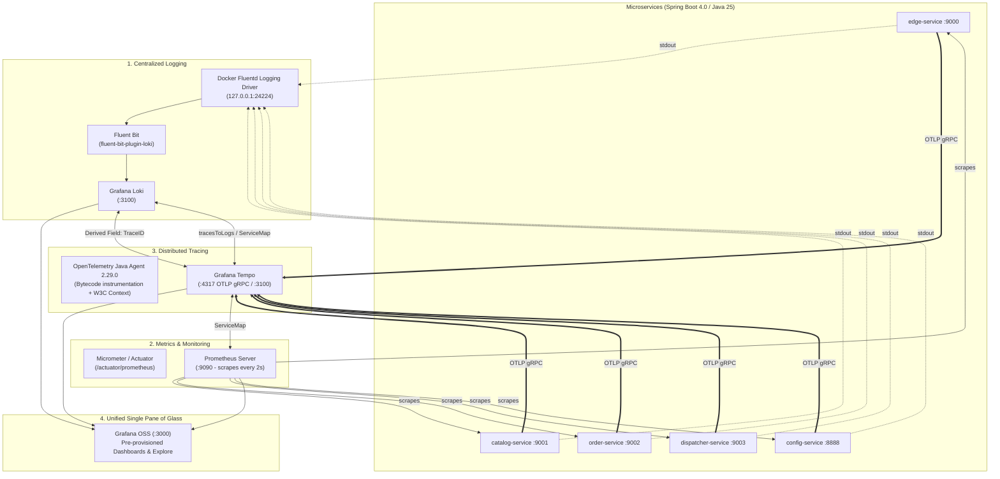
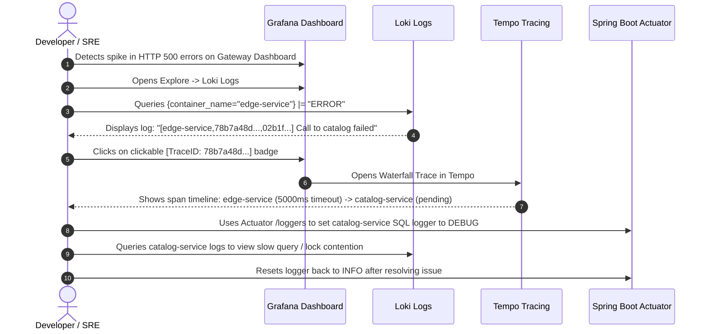

# 🔭 Observability & Monitoring Guide — Solar Bookshop

This document provides a comprehensive operational and practical reference for the **Observability and Monitoring stack** deployed in the Solar Bookshop microservices ecosystem, configured via [`docker-compose.yml`](./docker/docker-compose.yml).

The stack implements the four pillars of modern cloud-native observability:

1. **Centralized Logging** (Fluent Bit + Grafana Loki)
2. **Metrics & Monitoring** (Spring Boot Actuator + Micrometer + Prometheus)
3. **Distributed Tracing** (OpenTelemetry Java Agent + Grafana Tempo)
4. **Health & Deep Inspection** (Spring Boot Actuator Probes, Dynamic Loggers, Heap Dumps)
5. **Unified Visualization & Cross-Navigation** (Grafana)

---

## 🏗️ Architecture & Telemetry Data Flow



---

## ⚡ Quick Reference: Endpoints & Credentials

| Tool / Service | Container Name | Host URL / Port | Auth / Credentials | Purpose & Key Path |
| :--- | :--- | :--- | :--- | :--- |
| **Grafana** | `grafana` | [localhost:3000](http://localhost:3000) | `user` / `secret` | Unified dashboards, Explore (Logs, Traces, Metrics), Node Graph |
| **Prometheus** | `prometheus` | [localhost:9090](http://localhost:9090) | *None* | Time-series metrics engine, PromQL queries, target status (`/targets`) |
| **Grafana Loki** | `loki` | [localhost:3100](http://localhost:3100) | *None* | Log indexing & storage engine (`/loki/api/v1/push`) |
| **Fluent Bit** | `fluent-bit` | [localhost:24224](http://localhost:24224) | *None* | Fluentd-compatible forwarder forwarding container stdout to Loki |
| **Grafana Tempo** | `tempo` | [localhost:3110](http://localhost:3110) (HTTP) <br/> [localhost:4317](http://localhost:4317) (OTLP gRPC) | *None* | Distributed tracing storage, receives traces via OTLP gRPC |
| **Edge Service** | `edge-service` | [localhost:9000](http://localhost:9000) | OAuth2 / Keycloak | Spring Cloud Gateway, routes, rate limiter, session filter |
| **Catalog Service** | `catalog-service` | [localhost:9001](http://localhost:9001) | Bearer JWT | Book catalog service (Postgres backing) |
| **Order Service** | `order-service` | [localhost:9002](http://localhost:9002) | Bearer JWT | Reactive order processing (R2DBC Postgres + RabbitMQ) |
| **Dispatcher** | `dispatcher-service` | [localhost:9003](http://localhost:9003) | *Internal* | RabbitMQ order dispatch consumer/producer |
| **Config Service** | `config-service` | [localhost:8888](http://localhost:8888) | *Internal* | Centralized Git configuration server |

---

## 🚀 Launching the Stack

All services are orchestrated in [`solar-deployment/docker/docker-compose.yml`](./docker/docker-compose.yml).

### 1. Start the Entire Ecosystem

Navigate to the docker directory and launch (start `solar-keycloak` first as it takes time to bootup):

```bash
cd /home/hanuman/projects/solarbookshop/solar-deployment/docker
docker compose up -d
```

> [!IMPORTANT]
> **Fluent Bit Startup Dependency**:
> All microservices configure `logging: driver: fluentd` pointing to `127.0.0.1:24224`. If `fluent-bit` is not healthy and listening on port `24224` before the application containers start, Docker will fail to create the containers with connection refused. The `depends_on: [ fluent-bit ]` directive ensures correct boot ordering.

### 2. Start Only the Observability Infrastructure

If you want to run microservices locally from your IDE or terminal (e.g. for debugging) and keep only the observability tools in Docker:

```bash
docker compose up -d fluent-bit loki prometheus tempo grafana
```

### 3. Verify Container Status

```bash
docker compose ps
```

Ensure all five observability containers (`grafana`, `loki`, `fluent-bit`, `prometheus`, `tempo`) are in the `Up` state.

---

## 🛠️ Microservice Implementation Details (Spring Boot 4 / Java 25)

The microservices implement updated cloud-native standards (Spring Boot 4.0.0, Spring Cloud 2025.1.0, Java 25). Here is how each service integrates into the observability stack:

### A. Gradle Dependencies (`build.gradle.kts`)

Each service includes Actuator, Prometheus Micrometer, Resilience4j Micrometer, and the OpenTelemetry Java Agent:

```kotlin
extra["otelVersion"] = "2.29.0"

dependencies {
    implementation("org.springframework.boot:spring-boot-starter-actuator")
    runtimeOnly("io.micrometer:micrometer-registry-prometheus")
    runtimeOnly("io.github.resilience4j:resilience4j-micrometer")
    // Bundles the agent jar inside the container image artifact (/workspace/BOOT-INF/lib)
    runtimeOnly("io.opentelemetry.javaagent:opentelemetry-javaagent:${property("otelVersion")}")
}
```

### B. Correlation Logging & Actuator Configuration (`application.yml`)

```yaml
management:
  endpoints:
    web:
      exposure:
        include: configprops, env, gateway, health, heapdump, info, loggers, mappings, prometheus
  endpoint:
    health:
      show-details: always
      show-components: always
      probes:
        enabled: true
      validate-group-membership: false
      group:
        readiness:
          include: readinessState, redis # Custom readiness checks
  metrics:
    tags:
      application: ${spring.application.name}

logging:
  pattern:
    # Modern Spring Boot correlation pattern injecting MDC trace_id and span_id
    correlation: "[${spring.application.name:},%X{trace_id:-},%X{span_id:-}] "
  include-application-name: false
```

### C. Container Runtime Environment Variables (`docker-compose.yml`)

```yaml
environment:
  # Attaches OTel Java agent dynamically to JVM
  - JAVA_TOOL_OPTIONS=-javaagent:/workspace/BOOT-INF/lib/opentelemetry-javaagent-2.29.0.jar
  - OTEL_SERVICE_NAME=edge-service
  - OTEL_EXPORTER_OTLP_ENDPOINT=http://tempo:4317
  - OTEL_EXPORTER_OTLP_PROTOCOL=grpc
  # Prevent OTel from overriding Micrometer metrics and Fluent Bit logs
  - OTEL_METRICS_EXPORTER=none
  - OTEL_LOGS_EXPORTER=none
```

---

## 📊 Tool-by-Tool Guide & How to Use Them

---

### 1. 📈 Grafana (Unified Visualization & Navigation)

- **Host URL**: [localhost:3000](http://localhost:3000)
- **Login**: Username `user`, Password `secret`

Grafana is the single pane of glass connecting Metrics, Logs, and Traces together.

#### Pre-provisioned Dashboards

Navigate to **Dashboards** > **Applications** folder:

1. **JVM (Micrometer)** (`jvm.json`):
   - **Heap & Non-Heap Memory**: Live usage, max capacity, and committed memory per JVM memory pool.
   - **Garbage Collection**: GC pause durations (`jvm_gc_pause_seconds`) and allocation rates.
   - **Threads**: Total threads, daemon threads, and peak count (`jvm_threads_live_threads`).
   - **CPU & File Descriptors**: Process CPU usage vs. System CPU usage, open file descriptors.

2. **Spring Cloud Gateway** (`spring-cloud-gateway.json`):
   - **Request Throughput**: Real-time HTTP requests per second hitting the gateway.
   - **Response Codes**: Breakdown of `2xx`, `4xx`, and `5xx` responses.
   - **Latency per Route**: Duration histogram percentiles (p50, p95, p99) for `/books/**`, `/orders/**`, and `/`.

3. **Circuit Breaker (Resilience4j)** (`circuit-breaker.json`):
   - **State**: Real-time status of `catalogCircuitBreaker` and `orderCircuitBreaker` (`CLOSED`, `OPEN`, `HALF_OPEN`).
   - **Failure Rate**: Percentage of failed requests against the 50% failure rate threshold.
   - **Slow Call Rate**: Calls exceeding the 5s timeout threshold.
   - **Calls Buffered**: Sliding window buffer consumption (20 calls configured).

#### Explore Mode

Click **Explore** in the left sidebar (`/explore`) to execute ad-hoc queries against Loki, Prometheus, or Tempo. Use the **Split** button at the top-right to view Logs and Traces side-by-side.

---

### 2. 📝 Centralized Logging: Loki & Fluent Bit

- **Loki Internal Endpoint**: `http://loki:3100`
- **Fluent Bit Forwarder Port**: `24224`

#### How Logs Flow

1. Microservices write structured logs to `stdout`.
2. Docker's `fluentd` logging driver forwards standard out to Fluent Bit at `127.0.0.1:24224`.
3. Fluent Bit strips Docker metadata and attaches container labels (`container_name`).
4. Logs are pushed via HTTP to Loki at `http://loki:3100/loki/api/v1/push`.
5. Grafana queries Loki using **LogQL**.

#### Structured Correlation Format

Every log message is prefixed with:

```text
[<application-name>,<trace-id>,<span-id>]
```

Example:

```text
2026-11-03T14:30:15.123Z  INFO [edge-service,5b2938cf18471c35805562d98df67823,28b0304323c21a10] 1 --- [reactor-http-epoll-4] c.s.e.filters.LoggingFilter : Request routed to catalog-service
```

#### LogQL Query Cheatsheet (in Grafana Explore)

Select **Loki** as datasource and try these queries:

| Purpose | LogQL Query |
| :--- | :--- |
| **All logs from a service** | `{container_name="edge-service"}` |
| **Filter by error** | `{container_name="catalog-service"} \|= "ERROR"` |
| **Case-insensitive search** | `{container_name="order-service"} \|~ "(?i)exception"` |
| **Exclude noisy polling logs** | `{container_name="edge-service"} != "/actuator/health"` |
| **Filter by log level and text** | `{container_name="order-service"} \|= "WARN" \|= "timeout"` |
| **Log volume rate per second** | `rate({container_name="edge-service"}[1m])` |

#### 🔗 The Magic Pivot: Logs to Traces

Notice the `derivedFields` configured in [`datasource.yml`](./docker/observability/grafana/datasources/datasource.yml):

```yaml
derivedFields:
  - datasourceUid: tempo-thomas-vitale
    matcherRegex: '\[[^\]]+?,\s*([a-f0-9]{32})\s*,'
    name: TraceID
    url: $${__value.raw}
```

Whenever a log line contains a 32-character hexadecimal Trace ID, Grafana renders a **clickable blue `TraceID` button**. Clicking this button opens the exact distributed trace in Tempo without having to copy-paste anything!

---

### 3. ⏱️ Metrics & Monitoring: Prometheus & Micrometer

- **Host URL**: [localhost:9090](http://localhost:9090)
- **Actuator Scrape Path**: `/actuator/prometheus`
- **Scrape Interval**: 2 seconds (configured in [`prometheus.yml`](./docker/observability/prometheus/prometheus.yml))

#### Verifying Scrape Targets

1. Open [localhost:9090/targets](http://localhost:9090/targets).
2. Verify all five jobs (`edge-service`, `catalog-service`, `order-service`, `dispatcher-service`, `config-service`) report state **UP**.

#### Top PromQL Queries

| Metric / Purpose | PromQL Query |
| :--- | :--- |
| **HTTP Request Rate (by service & status)** | `sum(rate(http_server_requests_seconds_count[1m])) by (application, status)` |
| **95th Percentile Latency (p95)** | `histogram_quantile(0.95, sum(rate(http_server_requests_seconds_bucket[1m])) by (le, application, uri))` |
| **Heap Memory Used** | `jvm_memory_used_bytes{area="heap"}` |
| **Live Threads Count** | `jvm_threads_live_threads` |
| **CPU Usage by Microservice** | `process_cpu_usage * 100` |
| **Circuit Breaker Status (0=Closed, 1=Open, 2=Half-Open)** | `resilience4j_circuitbreaker_state` |
| **Circuit Breaker Failure Rate** | `resilience4j_circuitbreaker_failure_rate` |
| **Gateway Routing Requests** | `rate(spring_cloud_gateway_requests_seconds_count[1m])` |

---

### 4. 🔍 Distributed Tracing: OpenTelemetry & Tempo

- **Tempo OTLP gRPC Ingestion Port**: `4317`
- **Tempo UI Querying**: via Grafana Explore (Datasource: `Tempo`)

#### How Distributed Tracing Works

1. **Dynamic Bytecode Instrumentation**: At startup, `opentelemetry-javaagent-2.29.0.jar` intercepts HTTP requests, Spring WebFlux, Netty, Spring MVC, JDBC, R2DBC, Redis, and RabbitMQ calls.
2. **Context Propagation**: When `edge-service` forwards an HTTP request to `catalog-service` or `order-service`, it injects standard W3C headers (`traceparent`, `tracestate`).
3. **Trace Export**: Spans are shipped via gRPC to Tempo (`http://tempo:4317`).
4. **Trace Anatomy**:
   - **Trace ID**: Unique 32-character ID representing the entire end-to-end request.
   - **Span ID**: Unique 16-character ID representing an individual unit of execution.
   - **Tags/Attributes**: HTTP method, status code, URL path, database query statements, error messages.

#### Querying Traces in Grafana Explore

1. Go to **Explore** and select **Tempo** from the top-left dropdown.
2. Under the **Search** tab:
   - **Service Name**: Choose `edge-service`, `catalog-service`, etc.
   - **Span Name**: Filter by operation (e.g. `GET /books`, `SELECT solardb_catalog`).
   - **Min Duration**: Find slow requests (e.g. `500ms`).
   - **Status**: Filter by `Error` or `Success`.
3. Click **Run Query** and select a trace from the results table.
4. Inspect the **Trace Waterfall View**:
   - See the hierarchical timing breakdown from Gateway down to Postgres and RabbitMQ.
   - Click on any span to inspect tags (`http.status_code`, `db.statement`, `net.peer.name`).

#### 🔗 Traces to Logs Navigation

Inside the Tempo trace view:

- Next to each span, click the **Logs for this span** button.
- Tempo uses the pre-configured `tracesToLogs` mapping to query Loki for all logs emitted by that service within the exact time window of the span!

#### 🌐 Node Graph / Service Map

In Grafana Explore with Tempo selected, click **Node Graph** or **Service Map**:

- Displays an interactive topological diagram showing live request flows, error percentages, and latency between all microservices.

---

### 5. 🏥 Spring Boot Actuator: Probes & Runtime Operations

Spring Boot Actuator provides production-grade monitoring, health checks, and dynamic operations.

#### A. Kubernetes & Docker Health Probes

Spring Boot automatically creates two health groups:

1. **Liveness Probe**:

   ```bash
   curl -s http://localhost:9000/actuator/health/liveness | jq .
   ```

   - **Purpose**: Checks if internal application state is broken (e.g., deadlock, out of memory).
   - **Action if DOWN**: Container orchestrator restarts the container.

2. **Readiness Probe**:

   ```bash
   curl -s http://localhost:9000/actuator/health/readiness | jq .
   ```

   - **Purpose**: Checks if application is ready to handle user traffic (includes Redis and database connectivity).
   - **Action if DOWN**: Router stops sending requests to this instance until it recovers.

3. **Detailed Component Health**:

   ```bash
   curl -s http://localhost:9000/actuator/health | jq .
   ```
  
   - Displays status of `diskSpace`, `redis`, `ping`, and circuit breakers.

#### B. Dynamic Log Level Switching at Runtime (No Restart Required!)

You can view and modify log levels on running containers on the fly:

- **Check current level of a logger**:

  ```bash
  curl -s http://localhost:9000/actuator/loggers/org.springframework.cloud.gateway | jq .
  ```

- **Enable DEBUG logging dynamically**:

  ```bash
  curl -i -X POST http://localhost:9000/actuator/loggers/org.springframework.cloud.gateway \
       -H "Content-Type: application/json" \
       -d '{"configuredLevel": "DEBUG"}'
  ```

- **Reset logger back to INFO or default**:

  ```bash
  curl -i -X POST http://localhost:9000/actuator/loggers/org.springframework.cloud.gateway \
       -H "Content-Type: application/json" \
       -d '{"configuredLevel": "INFO"}'
  ```

#### C. Inspect Application & Build Information (`/actuator/info`)

```bash
curl -s http://localhost:9000/actuator/info | jq .
```

Returns Java version, OS details, runtime vendor, and configured system identifiers.

#### D. Inspect Gateway Routing Table (`/actuator/gateway`)

```bash
# List all active routes, filters, and predicates
curl -s http://localhost:9000/actuator/gateway/routes | jq .
```

#### E. Inspect Flyway Database Migrations (`/actuator/flyway`)

Available on `catalog-service` (9001) and `order-service` (9002):

```bash
curl -s http://localhost:9001/actuator/flyway | jq .
```

Shows every applied SQL migration script, execution timestamp, and checksum.

#### F. Generating and Downloading Heap Dumps (`/actuator/heapdump`)

If you suspect memory leaks or excessive memory usage:

```bash
curl -O http://localhost:9000/actuator/heapdump
```

Generates a standard `.hprof` binary file. You can open and analyze it with **Eclipse Memory Analyzer Tool (MAT)**, **VisualVM**, or **JProfiler**.

---

## 🎯 Practical End-to-End Troubleshooting Walkthrough

Here is how an SRE or developer diagnoses an incident using this unified stack:



---

## ⚠️ Troubleshooting & Common Pitfalls

1. **Error: `failed to initialize logging driver: dial tcp 127.0.0.1:24224: connect: connection refused`**:
   - **Cause**: Application started before Fluent Bit was ready.
   - **Fix**: Run `docker compose up -d fluent-bit` first, wait 2 seconds, then run `docker compose up -d`.

2. **No Traces Appearing in Tempo**:
   - Check that `OTEL_EXPORTER_OTLP_ENDPOINT` is set to `http://tempo:4317` with `OTEL_EXPORTER_OTLP_PROTOCOL=grpc`.
   - Verify that the Java agent JAR is present in the container at `/workspace/BOOT-INF/lib/opentelemetry-javaagent-2.29.0.jar`.

3. **Prometheus Target Shows `DOWN`**:
   - Check if the microservice is running and port is reachable.
   - Test manually: `curl http://localhost:<port>/actuator/prometheus`.
   - Verify `management.endpoints.web.exposure.include` contains `prometheus`.

4. **Missing TraceID in Logs**:
   - Ensure `logging.pattern.correlation: "[${spring.application.name:},%X{trace_id:-},%X{span_id:-}] "` is configured in `application.yml`.
   - Ensure the OpenTelemetry Java Agent is loaded via `JAVA_TOOL_OPTIONS`.

---

## 📚 References & Further Reading

- [Grafana Documentation](https://grafana.com/docs/)
- [Grafana Loki LogQL Guide](https://grafana.com/docs/loki/latest/query/)
- [Grafana Tempo Tracing](https://grafana.com/docs/tempo/latest/)
- [Prometheus Querying Basics](https://prometheus.io/docs/prometheus/latest/querying/basics/)
- [Spring Boot 4 / 3.x Actuator Documentation](https://docs.spring.io/spring-boot/docs/current/reference/html/actuator.html)
- [OpenTelemetry Java Instrumentation](https://opentelemetry.io/docs/languages/java/automatic/)
